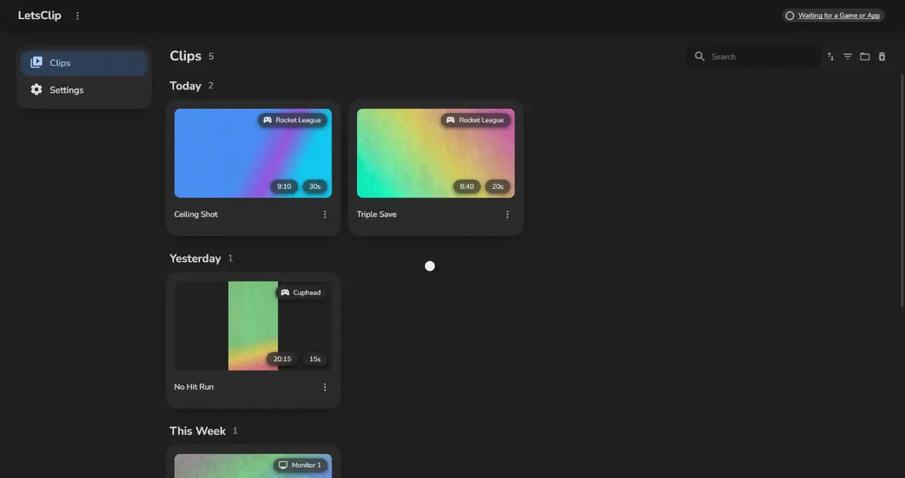

# LetsClip

## Features
- Keeps up to the last 30 minutes of your game, app or monitor in the background, saved with one key
- Finds your games by itself and records just their window, with the game and voice chat or everything your PC plays
- Your microphone and voice chat cleaned of background noise, each on a track of its own
- A crash or a closed game still leaves the moments before it to save, and a fresh clip can grow into what came after
- Clips grouped by day and game, with filters, a preview on hover and search by what was said
- Trim to the frame and crop freely without losing quality, with captions if you like
- Exports that fit Discord's limits, posted to your channel or copied straight into Discord
- Shrinks old clips to about two fifths of their size, and brings deleted ones back from the Recycle Bin
- Updates itself in the background

## Quick start
1. Download the exe from the [latest release](https://github.com/poolfullofmilk/LetsClip/releases/latest)
2. Run it, it puts itself in place
3. Press F10 to save a clip, then open it to trim and export

## ⚠️ Important
- Nothing leaves your PC unless you post it; speech is recognised on it, after a one time 187 MB download
- Locking Windows, sleep or the display turning off clears the unsaved replay
- HDR is not supported, and borderless works better than exclusive fullscreen
- Made for Windows 11; Windows may warn on the first run since the app is not signed: More info, then Run anyway

## Technical details
- .NET 11, WPF, Blazor and MudBlazor in one self-contained exe
- Its own slim FFmpeg build records and exports on your graphics card (AMD, NVIDIA or Intel), and its own whisper.cpp build hears speech
- GPL-3.0, see [THIRD-PARTY-NOTICES.txt](THIRD-PARTY-NOTICES.txt)
