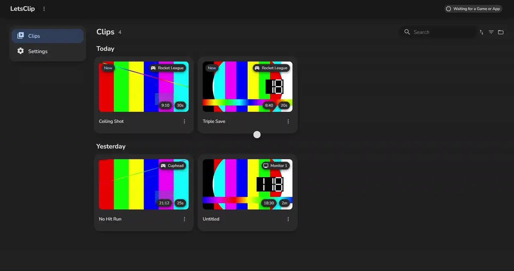
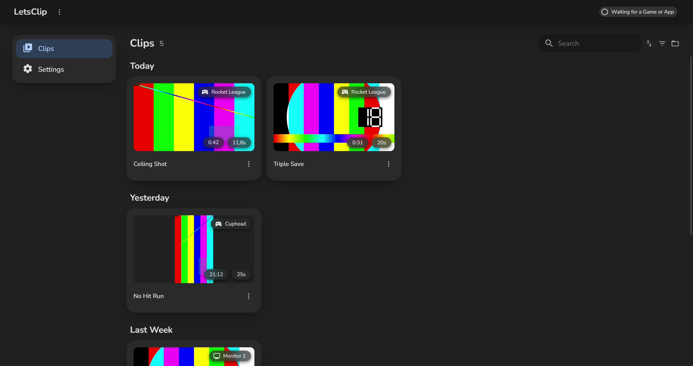
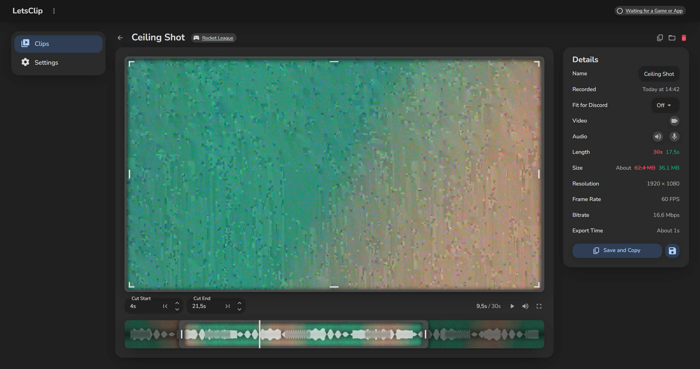
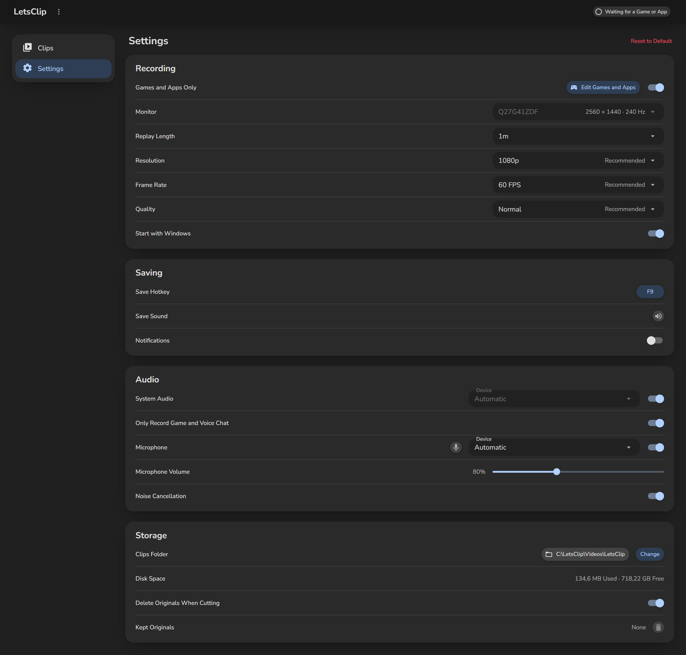

# LetsClip

## Features
- Keeps the last 30 seconds to 10 minutes of your game, app or monitor, ready to save with one key
- Starts with Windows in the tray and records by itself, and the status says what it records, how much a save holds, and opens the fix when something is wrong
- Games and Apps Only records just the game's window, so chats and notifications stay out
- Finds your games from Steam, Epic, Riot, Rockstar, Roblox and the Xbox app, and the ones Windows saw you play from Battle.net, Ubisoft or EA, even ones installed while it runs
- Add any other app or game from one list, and a game it does not know yet is offered once it fills your screen or when you press the key in it
- A game always goes before an app you added, so a browser left open never takes its place
- Records the game's real window, past splash screens and hidden windows, and follows a game like Roblox when it opens a new one
- Give a game its own replay length, resolution, frame rate and quality
- Recommended marks the best quality for your PC, or record up to your monitor's own resolution and refresh rate
- The replay waits in memory, so recording all day barely writes to your SSD
- Records only your game and voice chat (Discord, Vesktop, TeamSpeak, Mumble, Steam), or everything your PC plays
- Voice chat and your microphone each have a volume of their own
- Your microphone is cleaned of background noise with quiet words brought up, and gets a track of its own
- Test your microphone live and hear how it will sound in a clip
- Record keeps everything from your press until you stop as one clip, the tray icon red meanwhile
- If your game crashes, closes or restarts, the moments before it are still there to save
- Spamming the key saves one clip, not a pile of copies
- A different sound tells you when a press saved nothing, and no notification ever plays a Windows sound over your game
- Turn on Notifications for a small toast over your full screen game when a clip is saved or a game starts recording
- A clip that comes out black always tells you, with the fix
- Clips are named after their game and time, and renaming a clip renames its file, so it shares under that name
- Clips sit under Today, Yesterday, This Week, Last Week and then each month, each header with its count and each clip tagged with its game, app or monitor
- Search, sort and filter clips by game, app or monitor, or to the ones you have not edited yet
- Clips saved since you last looked are marked New, and resting the pointer on one previews it
- Copy any clip as a file and paste it straight into Discord, or drag its card into Discord or a folder
- Copy a clip sized for your Discord plan straight from its card, and copy its last export again any time
- Deleting a clip can be undone for a moment, and Recently Deleted brings it back from the Recycle Bin with its trim and name, like the full clip a cut set aside
- Stays quick with thousands of clips, the pictures on screen made first
- Trim to the exact frame by dragging, typing or stepping, over a strip with the game and your voice drawn in their own colours that the mouse wheel zooms
- Keep just the trimmed part without losing any quality, the full clip kept or sent to the Recycle Bin, and Restore Original brings it back either way
- Export an exact copy, or fit Discord's Free, Nitro Basic or Nitro limit as HEVC at the size that looks sharpest, even for long selections
- Crop to any part of the picture by dragging the box's corners or sides, move it anywhere, and reset it in one click
- Leave out your voice or the game, or balance the two, and exports even out the sound so it is never too quiet in Discord
- Share only the sound, like a long voice chat, as a file Discord plays right in the chat
- The length, size, bitrate and time shown before an export are what you get, and follow every drag as you make it
- Exports keep going when you leave the editor and wait their turn, with their progress in the top bar
- A problem, like keys another app already uses or an almost full drive, shows as a small chip next to where you fix it, and a setting that does not apply right now says Not Used
- Changing the clips folder moves every clip with its details, with a progress bar
- Moving or renaming clips in Explorer, to a USB drive or out of a backup, keeps their names, trims and games
- Keeps recording through a dock, a monitor switched off or on, or another monitor changing its refresh rate
- Sound stays whole on a busy PC, and a headset or speakerphone dropping out and back never cuts it
- Change the replay length while it records, nothing is lost
- Remembers where you left its window and how loud you play clips
- Updates itself in the background with signed updates, never during a recording you started, and shows what changed
- Recovers from problems on its own, even a crash
- Report a Problem opens a GitHub issue with the log ready to paste, your user folder left out
- Uninstalls from Windows' own Apps list, and your clips stay

## Quick start
1. Download the exe from the [latest release](https://github.com/poolfullofmilk/LetsClip/releases/latest)
2. Run it from anywhere, it puts itself in place and there is nothing to install
3. Press F10 to save a clip, then open it to trim and export

## ⚠️ Important
- Nothing leaves your PC, and nothing is kept until you save a clip
- Locking Windows, sleep or the display turning off clears the unsaved replay
- HDR is not supported yet, and exclusive fullscreen may not be captured: play borderless
- Made and tested for Windows 11
- Windows may warn on the first run because the app is not signed: click More info, then Run anyway

## Technical details
- .NET 11, WPF, Blazor and MudBlazor, one self-contained exe
- Its own slim FFmpeg 9.0.2 build records and exports with your graphics card's encoder (AMD, NVIDIA or Intel) and sizes and converts the picture on the card where it can, NAudio captures the audio
- Discord exports are HEVC, which Discord plays on desktop and web and almost every phone decodes; the card's H.264 takes over where HEVC is missing
- GPL-3.0, see [THIRD-PARTY-NOTICES.txt](THIRD-PARTY-NOTICES.txt)

## Screenshots

### Demo

### Clips

### Editor

### Settings

