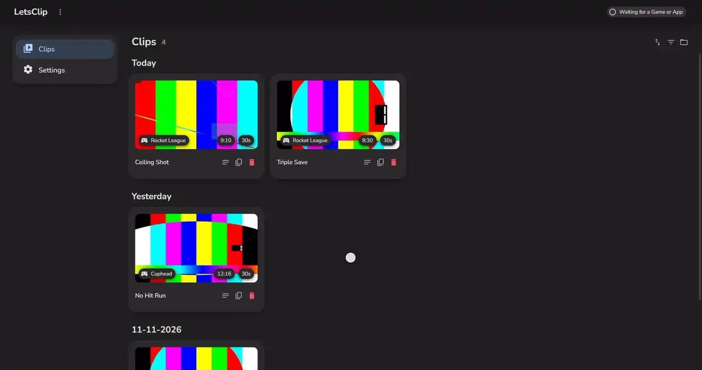
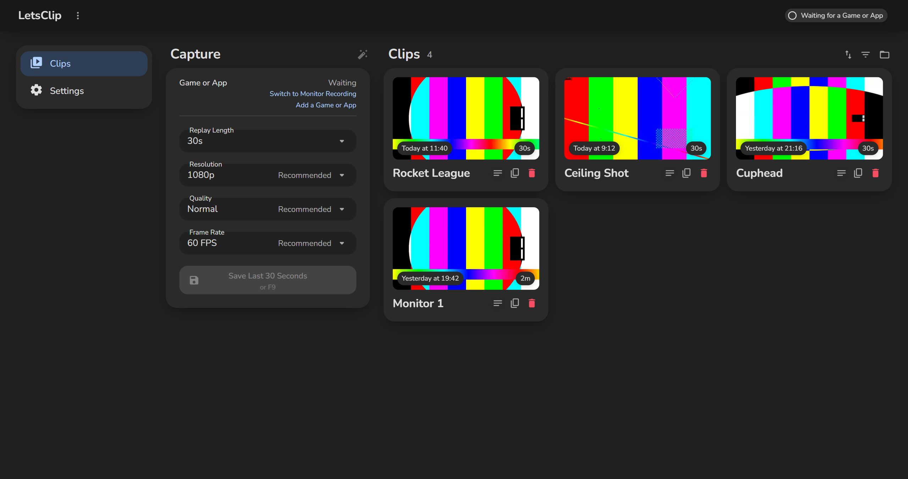
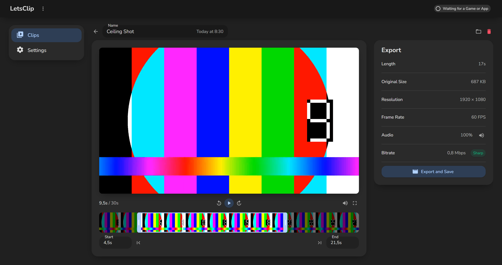
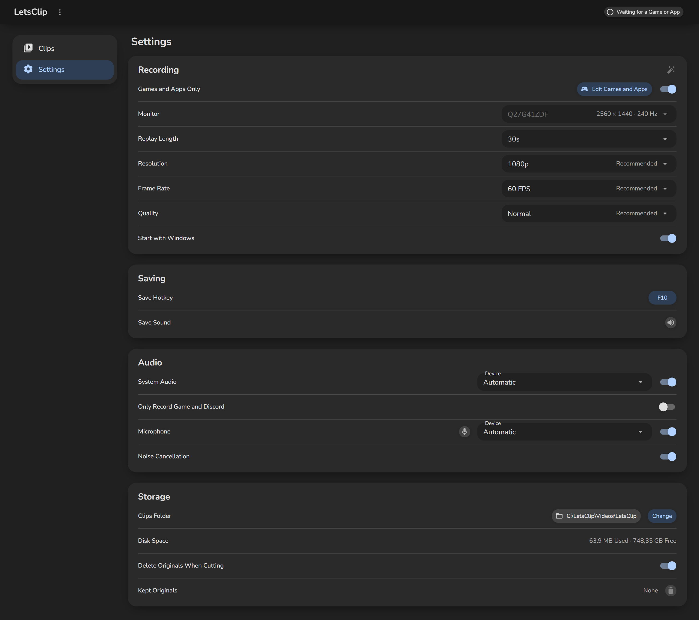

# LetsClip

## Features
- Keeps the last moments of your game, app or monitor, ready to save with one key
- Games and Apps Only records just that window, so chats and notifications stay out, and you pick any installed game or app from one list
- Press the key in a game LetsClip does not know yet and it offers to record that game from then on
- One click picks the recommended quality, or record up to your monitor's own resolution and refresh rate
- Records system audio, or only your game and Discord, and your microphone with its background noise cleaned out
- Test your microphone live and hear how it will sound in a clip
- Trim a clip to the exact frame and export an exact copy of it, or fit it to Discord's Free, Nitro Basic or Nitro limit, with or without sound
- Keep just the trimmed part without losing any quality, and keep the full clip to bring back if you want
- Clips are named after their game or app and show their resolution, bitrate and size, rename them, sort them and filter them by game
- Rest the pointer on a clip to preview it
- Copy any clip as a file and paste it straight into Discord
- A different sound tells you when a press saved nothing, and no notification ever plays a Windows sound over your game
- Spamming the key saves one clip, not a pile of copies
- Finds your games wherever Steam is installed, and games from the Xbox app
- Starts with Windows in the tray, updates itself in the background with signed updates and recovers from problems on its own, even a crash

## Quick start
1. Download the exe from the [latest release](https://github.com/poolfullofmilk/LetsClip/releases/latest)
2. Run it from anywhere, it puts itself in place and there is nothing to install
3. Press F10 to save a clip, then open it to trim and export

## ⚠️ Important
- Nothing leaves your PC, and nothing is kept until you save a clip
- Locking Windows, sleep or the display turning off clears the unsaved replay
- HDR is not supported yet, and exclusive fullscreen may not be captured: play borderless
- Windows 10 needs the Microsoft Edge WebView2 Runtime, Windows 11 already has it
- Windows may warn on the first run because the app is not signed: click More info, then Run anyway

## Technical details
- .NET 11, WPF, Blazor and MudBlazor, one self-contained exe
- A bundled FFmpeg 9.0.2 records and exports with your graphics card's encoder (AMD, NVIDIA or Intel), NAudio captures the audio
- GPL-3.0, see [THIRD-PARTY-NOTICES.txt](THIRD-PARTY-NOTICES.txt)

## Screenshots

### Demo

### Clips

### Editor

### Settings

